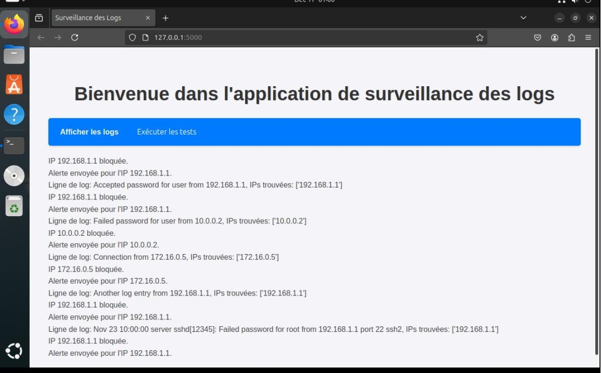
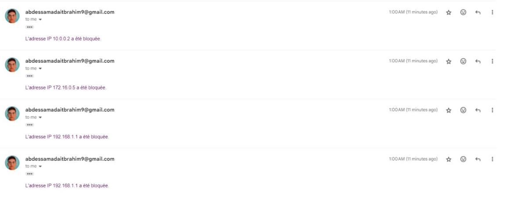

# SSH Log Monitoring with AI

A real-time SSH log monitoring system with AI-powered anomaly detection using Isolation Forest, automatic IP blocking, email alerts, and a Flask web dashboard.


---

## Academic Context

| | |
|---|---|
| **Institution** | National School of Applied Sciences of Tetouan (ENSA Tetouan) |
| **Program** | Big Data and Artificial Intelligence Engineering – 1st Year |
| **Course** | Introduction to Linux |
| **Developed by** | Abdessamad Ait Brahim |
| **Supervised by** | Dr. Kassou Manar |
| **Academic Year** | 2024–2025 |

---

## Project Overview

This project aims to monitor SSH authentication logs in real time and detect suspicious activities using machine learning.

### Key Features

- Real-time monitoring of SSH authentication logs.
- Anomaly detection using Isolation Forest.
- Automatic blocking of suspicious IP addresses with `iptables`.
- Email notifications through Gmail SMTP.
- Flask web dashboard for log visualization.
- Automated unit testing using `cron`.

---

## System Architecture

<p align="center">
  
</p>

The system consists of four main components:

- **Log Collection:** Collects SSH authentication events from `/var/log/auth.log`.
- **AI Analysis:** Detects abnormal connection patterns using Isolation Forest.
- **Incident Response:** Blocks suspicious IP addresses and sends email alerts.
- **Web Dashboard:** Displays monitoring logs and provides testing functionality.

> Note: Elasticsearch is presented as a possible future enhancement. The current implementation stores events locally in `logs/ssh_activity.log`.

---

## Project Screenshots

### Web Dashboard



### Email Alerts



---

## Technologies

- Python 3.12
- Flask
- Scikit-learn
- Isolation Forest
- Pandas
- Linux / Ubuntu
- iptables
- SMTP / Gmail
- Cron
- Unittest

---

## Installation

**1. Clone the repository**

```bash
git clone https://github.com/abdessamadaitbrahim/ssh-log-monitoring-ai.git
cd ssh-log-monitoring-ai
```

**2. Create a virtual environment**

```bash
python3 -m venv env
source env/bin/activate
```

**3. Install dependencies**

```bash
pip install -r requirements.txt
```

**4. Configure email notifications**

```bash
cp .env.example .env
nano .env
```

Add your email configuration:

```env
SENDER_EMAIL=your.email@gmail.com
RECEIVER_EMAIL=recipient@example.com
EMAIL_PASSWORD=your_gmail_app_password
```

---

## Usage

**1. Preprocess the dataset and train the model**

Ensure that `data/raw/ssh_logs.csv` is available.

```bash
python3 src/preprocess.py
python3 src/train_ai_model.py
```

**2. Start SSH monitoring**

```bash
sudo env/bin/python src/log_monitor.py
```

**3. Launch the Flask dashboard**

```bash
python3 app.py
```

Access the application at:

http://127.0.0.1:5000

**4. Run unit tests**

```bash
python3 -m unittest tests/test_log_monitor.py
```

---

## Machine Learning Approach

The project uses **Isolation Forest**, an unsupervised machine learning algorithm for anomaly detection.

The main steps are:

1. **Preprocessing:** Extract relevant features from SSH authentication logs.
2. **Training:** Train the model using 80% of the dataset.
3. **Testing:** Evaluate the model using the remaining 20%.
4. **Detection:** Classify authentication events as normal (`1`) or anomalous (`-1`).
5. **Response:** Block suspicious IP addresses and send email notifications.

---

## Limitations

This project is an academic prototype and has the following limitations:

- Limited anomaly detection performance due to the dataset size.
- Some features are partially hardcoded.
- Log parsing may fail with different authentication log formats.
- Unit tests do not directly test the production implementation in `src/`.
- Firewall rules are not persistent after system restarts.
- Flask debug mode is not suitable for production.

---

## Dataset

Dataset source: [SSH Attack Detection Using Machine Learning](https://github.com/ozch/SSH-Attack-Detection-Using-Machine-Learning).

Used for educational and academic purposes.

---

## Author

**Abdessamad Ait Brahim**

Big Data and Artificial Intelligence Engineering Student  
National School of Applied Sciences of Tetouan, Morocco.

- GitHub: [@abdessamadaitbrahim](https://github.com/abdessamadaitbrahim)
- LinkedIn: [Abdessamad Ait Brahim](https://www.linkedin.com/in/abdessamad-aitbrahim/)

---

*Developed as an academic project for the Introduction to Linux course, 2024–2025.*
